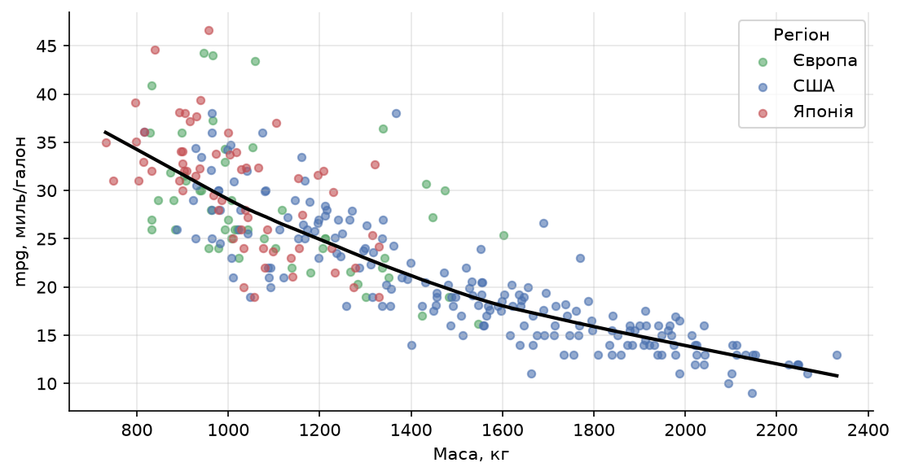
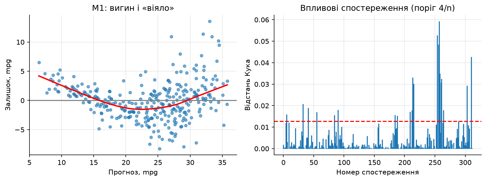
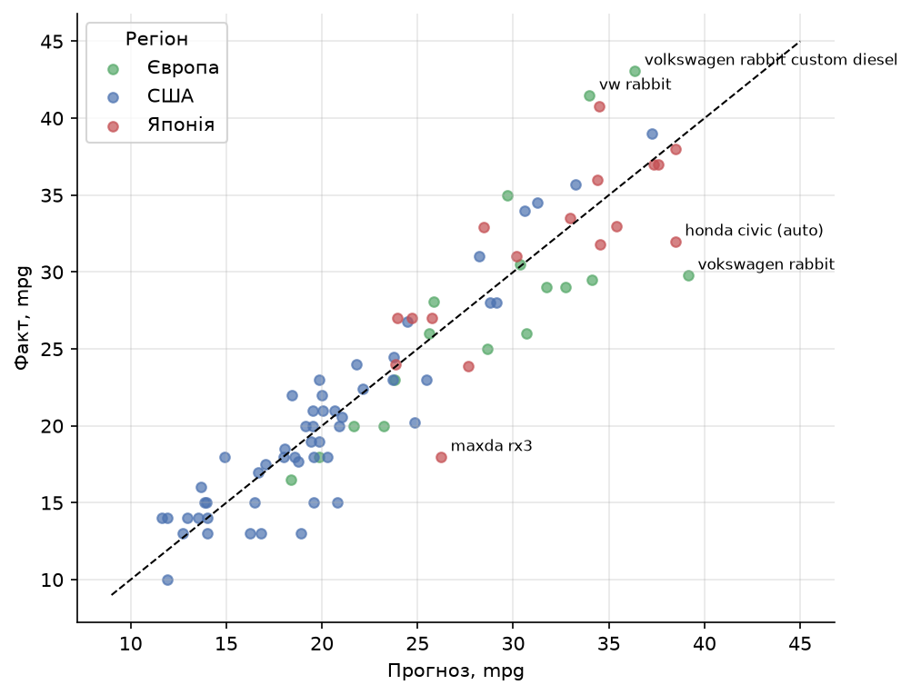

```{python}
import json
import pandas as pd
from IPython.display import Markdown
T = "outputs/tables/"
J = json.load(open("outputs/summary.json", encoding="utf8"))
def uk(x, d=2): return f"{x:.{d}f}".replace("-", "−").replace(".", ",")
def md(d, n=2): return Markdown(d.map(lambda v: uk(v, n) if isinstance(v, float) else v).to_markdown(index=False, disable_numparse=True))
tm = pd.read_csv(T + "test_metrics.csv"); c1 = pd.read_csv(T + "coef_M1.csv"); c2 = pd.read_csv(T + "coef_M2c.csv")
```

## Питання та гіпотези

**Питання.** Наскільки точно маса, потужність, рік і регіон прогнозують `mpg` **моделі, якої немає в навчальних даних**?

Auto MPG (UCI, CC BY 4.0): 398 авто, США, 1970–1982. Продовження лабораторної №2.

- **H1.** За інших рівних важчі авто мають менше mpg (Reynolds & Kandlikar, 2007).
- **H2.** За інших рівних новіші авто мають більше mpg (Knittel, 2011; EPA).

Гіпотези підказані й EDA на тому самому наборі, тому висновки **розвідувальні**.

::: {.notes}
Це продовження другої лабораторної: ті самі дані й ціль. Одиниця спостереження — модель певного року.
:::

## EDA: зв'язок із масою сильний, але нелінійний

{height=430 fig-align="center"}

Рішення: перевірити квадрат маси та логарифмічну форму.

::: {.notes}
Графік побудовано лише на навчальній частині. EDA з ЛР2 охоплювала всі дані — це обмеження незалежності тесту.
:::

## Як перевіряли, щоб не було витоку

- Поділ 80/20 **за назвою моделі**: `{python} J['n_train']` / `{python} J['n_test']`, seed 42
- Групова 5-кратна CV × 10 повторів, однакові розбиття для всіх моделей
- Імпутація, масштабування, поправка Дуана — лише на навчальній частині розбиття
- Основна метрика **RMSE**; правило вибору записано до тесту
- Тест відкрито один раз — для обраної моделі та константи

## Базова регресія підтримує H1 і H2

```{python}
md(c1)
```

Ціль — mpg; кластерно-стійкі 95 % ДІ. Для потужності ДІ містить 0.

::: {.notes}
Константа — середнє навчальної частини. Коефіцієнти — умовні асоціації, а не причинні ефекти.
:::

## Діагностика: лінійна форма не підходить

{height=420 fig-align="center"}

Вигин → бракує нелінійності; «віяло» → більший розкид в економних авто.

## Log-log має найменшу похибку

::: {style="font-size:0.72em"}
```{python}
md(pd.read_csv(T + "cv_summary.csv"))
```
:::

CV на навчальній частині, mpg, середнє ± SD за 50 розбиттями. Обрано **M2c**.

::: {.notes}
Ridge не допоміг: проблема у формі зв'язку. Випадковий ліс близький, але не кращий і менш інтерпретований. Розбиття перекриваються, тому вони не незалежні.
:::

## Обрана модель: еластичності

ln mpg ~ ln маси + ln потужності + рік + регіон

```{python}
md(c2, 3)
```

+1 % маси ↔ приблизно `{python} uk(c2.loc[c2['Член']=='ln маси','Оцінка'].iloc[0])` % mpg

## Тест: похибка на `{python} uk(J['gain_pct'],0)` % менша за константу

:::: {.columns}
::: {.column width="52%"}

:::
::: {.column width="48%"}
```{python}
md(tm[["Модель", "RMSE", "RMSE, 95 % ДІ", "MAE"]])
```

Найбільші промахи — економні авто: дизельний VW Rabbit, роторна Mazda RX-3. Типу пального в ознаках немає.
:::
::::

## Висновки та межі

- mpg нової моделі прогнозується з RMSE ≈ `{python} uk(tm.RMSE.iloc[1],1)` mpg; для економних авто — гірше
- **H1 і H2 узгоджуються з даними** (розвідувально); зв'язок із масою нелінійний
- Виграш дала форма зв'язку, а не складніший алгоритм

**Межі:** ринок США 1970–1982; тест не цілком незалежний від ЛР2; немає типу пального й трансмісії; асоціації, не причинність.

**Далі:** додати ці ознаки та перевірити на авто 1983–1985 рр.

Репозиторій: <https://github.com/Cut1e1337/Lab03_Tabachuk_Oleksandr>
